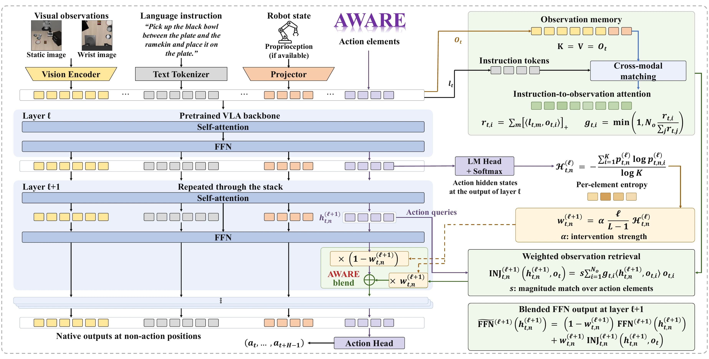
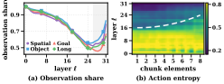
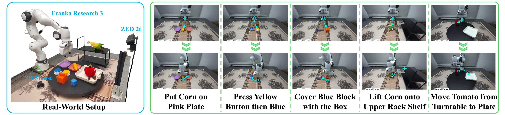

<div align="center">

# AWARE: Action-Entropy-Weighted and Attention-Guided Retrieval of Observation Evidence for Vision-Language-Action Models

A **training-free, plug-and-play** inference framework for Vision-Language-Action (VLA) models that tracks per-element **Action Entropy** across layers and retrieves instruction-grounded observation evidence through the model's native Feed-Forward Networks (FFNs) — requiring *no fine-tuning, no extra sensors, and no auxiliary parameters*.

[**\[📄Paper\]**](https://arxiv.org/abs/2602.18020) &nbsp;&nbsp; [**\[🏠Project Page\]**](https://jiabingyang01.github.io/AWARE/) &nbsp;&nbsp; [**\[🎬Rollout Videos\]**](https://jiabingyang01.github.io/AWARE/#rollouts) &nbsp;&nbsp; [**\[🔌Integration Guide\]**](integrations/README.md) &nbsp;&nbsp; [**\[🌏简体中文\]**](README_zh.md)

[](https://jiabingyang01.github.io/AWARE/)
[-21918c?style=flat-square)](#--experimental-results)
[](#--experimental-results)
[](LICENSE.md)

</div>

---

## 🔥 News

* **`2026.10`** 🌟 **AWARE** code, interactive [Project Page](https://jiabingyang01.github.io/AWARE/), diagnostic probes, and evaluation suites for **7 VLA backbones** across **LIBERO, SIMPLER, CALVIN, and Real-World Franka Research 3** are released!

## 👀 Contents

- [Model Overview](#-model-overview)
- [Quick Start & Integration](#-quick-start--integration)
- [Evaluation & Diagnostic Probes](#-evaluation--diagnostic-probes)
- [Experimental Results](#-experimental-results)
- [Repository Layout](#-repository-layout)
- [Acknowledgement](#-acknowledgement)
- [Citation](#-citation)

## 📋 Model Overview



During a VLA model's forward pass, two representational bottlenecks emerge as tokens traverse the transformer stack:
1. **Observation Subspace Decay**: The proportion of the action representation explained by observation tokens diminishes monotonically with depth, losing roughly half of its subspace footprint by layer 26 across all LIBERO suites.
2. **Asynchronous Uncertainty Convergence (Decision Wavefront)**: Within an action chunk ($H=8, D_a=7, N_a=56$), near-term trajectory steps converge in middle layers while distant future steps retain elevated predictive entropy until deep layers.

<div align="center">
  
</div>

Building on the insight that Transformer Feed-Forward Networks (FFNs) act as key-value associative memories, **AWARE** lets each action element autonomously regulate its own observation retrieval at inference time:
- **1. Read (Element-Wise Action Entropy)**: At layer $\ell$, each action element projects its hidden state through the frozen language head (`Logit Lens`) to compute normalized entropy $\mathcal{H}^{(\ell)}_{t,n} \in [0, 1]$ over $K=256$ candidate bins.
- **2. Weigh (Instruction-Guided Conditioning)**: Cross-modal alignment between instruction tokens and visual observation patches computes a parameter-free importance gate $\boldsymbol{g}_t$ once per policy call, attenuating background distractors.
- **3. Retrieve (Associative Memory Lookup)**: At layer $\ell+1$, each action element queries the encoded observation memory $\boldsymbol{O}_t$ via two lightweight matrix products: $\textsc{inj}_{t,n}^{(\ell+1)} = s\,\boldsymbol{O}_t^{\top}\operatorname{diag}(\boldsymbol{g}_t)\,\boldsymbol{O}_t\,\boldsymbol{h}_{t,n}^{(\ell+1)}$.
- **4. Write (Continuous Adaptive Blending)**: The retrieved features are blended into the element's FFN output with weight $w^{(\ell+1)}_{t,n} = \alpha\,\tfrac{\ell}{L-1}\,\mathcal{H}^{(\ell)}_{t,n}$, selectively reinforcing high-entropy dimensions in deep layers while leaving converged representations intact.

## 🔧 Quick Start & Integration

**Requirements**: Python $\ge$ 3.10, PyTorch $\ge$ 2.0, and `numpy`. The `aware/` hooks introduce **zero external dependencies** beyond what the host VLA policy already uses.

### 1. Attach AWARE Hooks (One-Line Integration)

Nothing is installed unless `AWARE_ALPHA` is set in the environment — when `AWARE_ALPHA` is unset, the policy remains **byte-identical** to the untouched checkpoint.

```python
# OpenVLA-OFT (parallel chunk decoding, N_a = 56)
from aware import install
state = install(vla, use_proprio=True)
```

```python
# Causal autoregressive & dual-system VLAs (OpenVLA, SpatialVLA, CogACT, LLaVA-VLA)
from aware import install_generic
state = install_generic(language_model, n_obs=256, n_act=1, obs_offset=0)
```

```python
# openpi (pi0 / pi0.5, PyTorch path)
from aware import pi0
state = pi0.maybe_install(model)
```

### 2. Enable at Inference Time

```bash
export AWARE_ALPHA=0.03 \
       AWARE_TRIGGER=soft \
       AWARE_SOFT_DEPTH=ramp \
       AWARE_SELECT=instruction
```

| Backbone Family | Representative Models | Entropy Read Position | Default $\alpha$ Range |
|---|---|---|---|
| **Parallel Chunk Decoding** | OpenVLA-OFT (7B) | All $N_a = 56$ action placeholder tokens simultaneously | `0.03 – 0.10` |
| **Causal Autoregressive** | OpenVLA (7B), SpatialVLA (4B), LLaVA-VLA (0.5B) | Each newly decoded action token ($N_a = 1$) | `0.01 – 0.08` |
| **Dual-System Diffusion** | CogACT (7B) | Cognition token conditioning the action expert | `0.09` |
| **Flow-Matching Expert** | $\pi_0$ (3B), $\pi_{0.5}$ (3B) | Instruction tokens in the PaliGemma conditioning prefix | `0.01 – 0.08` |

See [`integrations/README.md`](integrations/README.md) for per-backbone wiring details, switch descriptions, and the three-step verification gate (`Identity`, `Layout Proof`, `Effect`).

## 🧪 Evaluation & Diagnostic Probes

### Benchmark Evaluation Launchers (`eval/`)

```bash
# LIBERO — OpenVLA-OFT / OpenVLA-7B / pi0 & pi0.5
python eval/run_libero_oft.py
bash eval/ovla_cell_aware.sh
python eval/run_aware_pi0.py --model pi0 --suite libero_10 --alpha 0.03 --seed 7

# SIMPLER (Visual Matching) — CogACT (Google Robot) & SpatialVLA (WidowX)
python eval/run_aware_cogact.py --alpha 0.09 --seed 7
ARM=aware ALPHA=0.08 bash eval/sv_aware_cell.sh

# CALVIN (ABC -> D) — LLaVA-VLA (0.5B)
ARM=aware ALPHA=0.01 bash eval/calvin_cell_v5.sh
```

### Mechanistic & Representation Probes (`analysis/`)

```bash
python analysis/probe_obs_footprint.py          # Fig. 1(a): Layer-wise observation subspace footprint decay
python analysis/probe_chunk_entropy_spread.py   # Fig. 1(b): Element-wise Action Entropy & decision wavefront
python analysis/sv_aware_gate.py                # Three-step integration verification gate on SpatialVLA
python analysis/test_rule_identity_cpu.py       # CPU unit test verifying alpha=0 bit-identity
```

## 📈 Experimental Results

### 1. Simulation Benchmarks (LIBERO, SIMPLER, CALVIN)

Across **7 VLA backbones** (0.5B to 7B parameters), AWARE consistently improves manipulation success over untouched official checkpoints, with the largest gains on extended-horizon tasks (**LIBERO-Long**, **SIMPLER Multi-Stage Drawer+Apple**, and **CALVIN deeper task chains**):

| Method | Venue | LIBERO-Spatial | LIBERO-Object | LIBERO-Goal | LIBERO-Long | **LIBERO Avg.** |
|---|---|---:|---:|---:|---:|---:|
| OpenVLA (7B) | *CoRL'24* | 82.8 | 85.6 | 78.4 | 49.6 | 74.1 |
| **+ AWARE (Ours)** | — | **86.4** (+3.6) | **87.0** (+1.4) | **79.0** (+0.6) | **57.2** (+7.6) | **77.4** (+3.3) |
| $\pi_0$ (3B) | *RSS'25* | 96.4 | 97.2 | 93.8 | 81.2 | 92.2 |
| **+ AWARE (Ours)** | — | **98.2** (+1.8) | **98.6** (+1.4) | **94.4** (+0.6) | **84.0** (+2.8) | **93.8** (+1.6) |
| $\pi_{0.5}$ (3B) | *CoRL'25* | 98.2 | 98.6 | 97.6 | 92.6 | 96.8 |
| **+ AWARE (Ours)** | — | **99.2** (+1.0) | **99.6** (+1.0) | **98.4** (+0.8) | **94.0** (+1.4) | **97.8** (+1.0) |
| OpenVLA-OFT (7B) | *RSS'25* | 98.0 | 98.2 | 97.6 | 93.8 | 96.9 |
| **+ AWARE (Ours)** | — | **99.2** (+1.2) | **98.6** (+0.4) | **98.6** (+1.0) | **96.0** (+2.2) | **98.1** (+1.2) |

* **SIMPLER Visual Matching**: CogACT (7B) on Google Robot improves from 73.7% $\rightarrow$ **76.9%** (**+8.3%** on *Open Top Drawer and Place Apple*); SpatialVLA (4B) on WidowX improves from 42.7% $\rightarrow$ **44.8%**.
* **CALVIN ABC$\rightarrow$D**: LLaVA-VLA (0.5B) boosts subtask completion by **+4.2%**, **+5.0%**, and **+3.4%** at chain depths 3, 4, and 5, raising full 5-subtask completion from 47.0% $\rightarrow$ **50.4%** and average chain length from 3.49 $\rightarrow$ **3.63**.
* **Minimal Overhead**: Adds only **+2.6 ms** per environment step on OpenVLA-OFT (29.4 ms $\rightarrow$ 32.0 ms on a single NVIDIA A100 GPU), sustaining **68.1 Hz** action throughput.

### 2. Real-World Manipulation (Franka Research 3, 2,000 Rollouts)



Evaluated across **5 tabletop tasks** (*Put Corn on Pink Plate*, *Press Yellow Button then Blue*, *Cover Blue Block with the Box*, *Lift Corn onto Upper Rack Shelf*, and *Move Tomato from Turntable to Plate*) and **5 VLA backbones** (40 physical trials per task-model pair, 2,000 rollouts total), AWARE yields average gains of **+4.0% to +8.0%** across architectures, with single-task improvements up to **+17.5%**.

## 🗂️ Repository Layout

```text
AWARE/
├── aware/                  # Core AWARE package (hooks.py: operator; pi0.py: openpi PyTorch adapter)
├── integrations/           # Per-backbone wiring guides, environment switches, and verification gates
├── eval/                   # Evaluation launchers for LIBERO, SIMPLER, and CALVIN
├── analysis/               # Forward-pass probes (observation footprint, entropy wavefront, gate checks)
├── figures/                # Paper figure generation scripts
└── docs/                   # Interactive project page (https://jiabingyang01.github.io/AWARE/)
```

## 🙏 Acknowledgement

We thank the open-source communities behind
[OpenVLA](https://github.com/openvla/openvla) ·
[OpenVLA-OFT](https://github.com/moojink/openvla-oft) ·
[openpi ($\pi_0 / \pi_{0.5}$)](https://github.com/Physical-Intelligence/openpi) ·
[CogACT](https://github.com/microsoft/CogACT) ·
[SpatialVLA](https://github.com/SpatialVLA/SpatialVLA) ·
[LLaVA-VLA](https://github.com/LLaVA-VL/LLaVA-NeXT) ·
[LIBERO](https://github.com/Lifelong-Robot-Learning/LIBERO) ·
[SimplerEnv](https://github.com/simpler-env/SimplerEnv) ·
[CALVIN](https://github.com/mees/calvin).

This repository is released under the **MIT License** (see [`LICENSE.md`](LICENSE.md)).

## 📝 Citation

If you find AWARE useful for your research, please consider citing our paper:

```bibtex
@article{yang2026aware,
  title   = {AWARE: Action-Entropy-Weighted and Attention-Guided Retrieval of Observation Evidence for Vision-Language-Action Models},
  author  = {Yang, Jiabing and Chen, Yixiang and Xu, Yuan and Li, Peiyan and Wu, Xiangnan and Wen, Zichen and Fang, Bowen and Yu, Tao and Zhang, Zhengbo and Li, Yingda and Wang, Kai and Liu, Jing and Liu, Nianfeng and Huang, Yan and Wang, Liang},
  journal = {arXiv preprint arXiv:2602.18020},
  year    = {2026}
}
```
